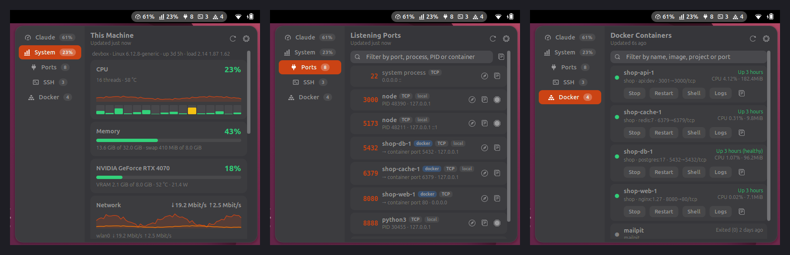

# OpsDeck

A GNOME Shell 50 top-bar menu for your dev machine:




- **Claude** (off by default, enable in Settings): plan usage (5-hour and weekly limits) for the account Claude Code is signed in with. The token in `~/.claude/.credentials.json` is only ever read, never refreshed or written, and is sent only to `api.anthropic.com`.
- **System**: this machine's CPU (with history and a per-core strip), memory and swap, temperature, GPUs, network rates, disks, battery and top processes. It covers what Termix's Host Metrics plugin shows, read locally from `/proc` and `/sys`. Disks, GPU, battery and processes are only read while the tab is open. A sleeping NVIDIA dGPU is never woken by polling. The top bar can show CPU %, memory % or CPU temperature.
- **Ports**: listening TCP sockets (UDP is optional) with process and PID. Actions: kill (TERM, then KILL), copy, and open in the browser.
- **SSH**: incoming logins (`who`) and outgoing `ssh` clients (`ss` plus `/proc`). You can end your own sessions. A **Tunnels** section lists the port forwards your ssh clients hold open (`-L`, `-R`, `-D` and `-o …Forward`), with open-in-browser and copy.
- **Docker**: containers via the CLI, with compose project and published ports. Running containers show CPU and memory, sampled only while the Docker tab is open. Actions: start, stop, restart, a shell in your terminal, and follow the logs.

In the Ports tab, ports published by Docker show the container that owns them, and ports held by an `ssh` client are tagged as tunnels.

Destructive actions need a second click to confirm. Kill is only offered for your own processes, and never for desktop-session processes (gnome-shell, Xwayland, pipewire, …). Each module can be toggled, has its own refresh interval and its own top-bar counter.

## Install

```sh
make install        # pack and install into ~/.local/share/gnome-shell/extensions
# Wayland: log out and back in, then
gnome-extensions enable opsdeck@nasif-naseef.github.io
```

To update a running OpsDeck without logging out, run `make reload` and paste the line it prints into Looking Glass (Alt+F2 → `lg`). It loads the new build from a fresh folder, because GNOME Shell caches loaded code by file path.

## Develop

```sh
npm install # once: ESLint (dev only, never shipped)
make lint   # ESLint with the gjs.guide rules
make test   # parser unit tests (gjs) and schema validation
make screenshots  # store screenshots with made-up data → docs/screenshots/
make smoke  # headless sandboxed gnome-shell: open every tab, cycle enable/disable 3x, fail on JS errors
make log    # follow OpsDeck messages in the journal
```

The smoke test runs on a private D-Bus session with a temporary HOME. It never touches your real shell, settings or credentials.

## Layout

```
extension/
  extension.js      lifecycle; one Scope cancels all I/O and timers on disable
  lib/              scope, subprocess, hub (polling and state), parsers
  sources/          ports, ssh, docker, claude: fetch, parse, actions (no UI)
  ui/               indicator, deck (dropdown), views/*
  prefs.js          Adwaita preferences
tests/              gjs unit tests and fixtures
scripts/            smoke-test.sh and a test-only driver extension
```
